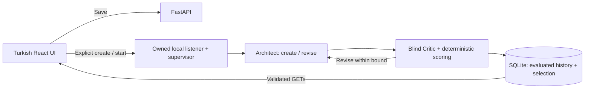

# PromptForge AI

PromptForge AI turns natural-language requests into useful prompts with an
Outcome-First Architect and an independent Critic. An effective original can be
preserved exactly; missing essential information can lead to clarification instead
of invented requirements. Useful specificity matters more than length.

**Scope: a trusted, single-operator local MVP.** There is no authentication or public
deployment qualification. Workflow reads and execution default to disabled. M5F-5B
prepares local qualification and documentation; release approval, Linux CI and final
integration review remain M5F-5C work.

## Implemented capabilities

| Area | Available behavior |
| --- | --- |
| Prompt requests | Save, persist, search, filter, paginate and reopen prompts/preferences |
| Architect | Preserve, rewrite or clarify; sparse canonical content and generic rendering |
| Critic | Blind independent assessment, nine criteria, evidence and deterministic scoring |
| Optimization | Explicit create then start; up to three evaluations and bounded revision/selection |
| Persistence | Migrated SQLite, fenced ownership, atomic evaluated history and finalization |
| Progress | Scoped GET polling while visible/active; terminal, error and pause stopping |
| Results | Backend-selected prompt, separate quality outcome, history, comparison and exact copying |
| Integrity | Revocation survives view remounts; only explicit fresh validated result reads can recover |



Saving never starts optimization. HTTP 202 means task acceptance, not completion or
quality approval. FAILED and CLARIFICATION_REQUIRED are terminal outcomes, not successful
final prompts. Fake tests establish contracts and UI behavior, not real-model quality.

## Start here

1. [Windows local setup](docs/local-mvp-setup.md): interpreter, frozen dependencies,
   connected SQLite qualification, dedicated database, frontend build and startup.
2. [Operations, configuration and security](docs/local-mvp-operations.md): exact modes,
   environment reference, provider costs, runtime limits and safe maintenance.
3. [Troubleshooting](docs/local-mvp-troubleshooting.md): safe diagnostics and resolutions.
4. [Acceptance and release checklist](docs/local-mvp-release-checklist.md): automated
   evidence, manual checks, reproducibility limits and M5F-5C gates.

Do not migrate or test against an existing personal database. Setup uses a new dedicated
database; backend tests and Chromium fixtures use disposable migrated databases.

## Application modes

| Mode | Purpose |
| --- | --- |
| Vite + ordinary API | PromptRequest UI development; workflow proxy paths deliberately denied |
| Ordinary API, flags off | PromptRequest APIs and health; workflow routes absent |
| Workflow API only | Guarded workflow GETs; no create/start routes or execution writer |
| Qualified local execution | Both flags, exact runtime, dedicated migrated DB and owned listener; built SPA optional |

Only `python -m app.core.execution_startup` can qualify the supported execution owner.
Ordinary Uvicorn, Vite and Vite preview cannot authorize execution. See the
[exact mode matrix](docs/local-mvp-operations.md#operating-modes).

## Technology and repository

| Layer | Stack |
| --- | --- |
| Frontend | React 19, Vite 8, strict TypeScript, Tailwind CSS 4, React Router, TanStack Query |
| Backend | Python 3.12, FastAPI, Pydantic 2, Uvicorn, uv |
| Storage | SQLite, aiosqlite, SQLAlchemy 2 async, Alembic |
| LLM | Existing LLMGateway, fake provider and OpenAI Responses adapter; generic renderer |
| Checks | pytest, strict mypy, Ruff, ESLint, Vitest/RTL/MSW, real Chromium Playwright |

```text
backend/                 API, agents, gateway, persistence, migrations, tests
frontend/                React UI, component tests, isolated Chromium E2E
docs/                    Contracts, operator guides, audit and ADRs
.github/workflows/       Backend, frontend and Chromium CI jobs
```

Execution qualification requires **Python 3.12.16** and safe SQLite versions observed
through actual sqlite3 and aiosqlite connections. Package/CLI versions are insufficient.
This Windows environment observed SQLite 3.53.1 in both drivers; other builds must
pass independently. See [prerequisites](docs/local-mvp-setup.md#prerequisites).

## Architecture and verification

- [Current architecture](docs/architecture.md) and [architecture decisions](docs/adr/README.md).
- [Workflow HTTP contracts](docs/workflow-api-contracts.md), [admission](docs/execution-admission.md),
  [supervisor](docs/execution-supervisor.md), [readback/recovery](docs/workflow-readback-recovery.md).
- [Backend](backend/README.md), [frontend](frontend/README.md), [LLM contracts](backend/app/llm/README.md).
- UI: [foundation](docs/frontend-workflow-integration.md), [creation](docs/frontend-workflow-creation.md),
  [progress](docs/frontend-workflow-progress.md), [results/history](docs/frontend-workflow-results.md).
- [M5F-5A security audit](docs/m5f-security-regression-audit.md), including SQL parameter
  hiding and the P1 remount/cache revocation correction.

The [setup guide](docs/local-mvp-setup.md#automated-checks) gives current check commands.
Backend typing includes migrations and benchmarks. Vitest discovers only
`src/**/*.test.{ts,tsx}`; Playwright uses `e2e/**/*.spec.ts`, one worker and zero retries.
Test counts are dated observations in the release checklist, not permanent guarantees.

[CI foundation and Linux qualification](docs/ci-qualification.md) describes the four
prepared checks, tool pins, artifact privacy and pending Linux/remote evidence.
Workflow configuration alone is not a successful GitHub Actions run.

## Boundaries and roadmap

Use one trusted local process; there is no waiting queue. Public binds, proxies,
containers and tunnels are unsupported. Same-origin/peer checks and listener ownership
are not authentication or HTTP flood protection. Unknown starts and unresolved paid
operations must not be automatically replayed. Exactly-once remote billing is not guaranteed.

Target-family preferences are stored and passed to the Architect, but only the generic
renderer and OpenAI real-provider adapter are implemented. Target-specific renderers,
additional providers, REA/multimodal analysis, voice, token analytics, direct reasoning
API controls, SSE, authentication and multi-worker operation remain future work.
Current application/package version metadata is `0.0.1`; M5F-5B creates no release tag.
