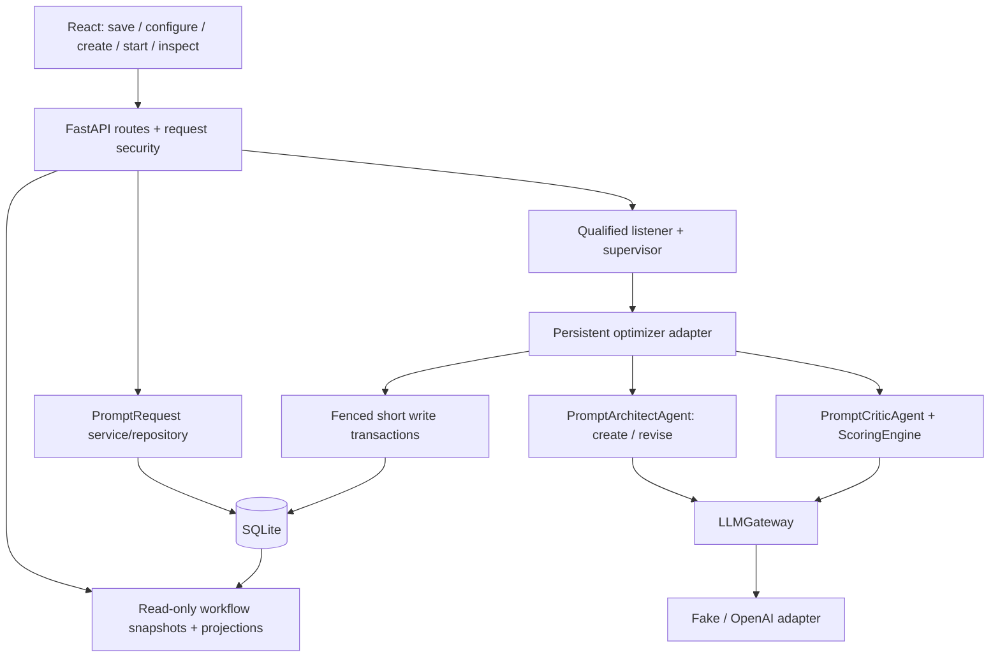

# PromptForge AI — current architecture

This inventory describes implemented behavior through M5F-5A and the M5F-5B local
qualification package. Earlier milestone numbers/ADR plans are historical design,
not proof that a feature is deployed. [Setup](local-mvp-setup.md), [operations/security](local-mvp-operations.md)
and [release evidence](local-mvp-release-checklist.md) own current operator instructions.

## Scope and layers

PromptForge AI is a modular monolith for a trusted single local operator. No
authentication, public deployment, distributed queue or multi-worker execution is implemented.
The UI remains Turkish; documentation may be English.

| Layer | Implemented components |
| --- | --- |
| Browser | React 19, Vite 8, strict TypeScript, Tailwind CSS 4, Router, one TanStack Query client |
| HTTP | FastAPI factory/lifespan, ordinary PromptRequest routes, six gated workflow GETs, separate create/start POSTs |
| Execution | Explicit owned-listener startup, one supervised asyncio task, fenced admission/dispatch |
| Optimization | Architect create/revise, blind Critic, deterministic scoring/selection, up to three evaluations |
| LLM | Existing LLMGateway, fake provider and OpenAI Responses adapter |
| Storage | Five SQLAlchemy models, async SQLite, Alembic head `0002_workflow_persistence`, dedicated read/write engines |

Agents do not call each other, HTTP or the database. The optimizer coordinates them;
agents use the gateway, SDK types remain inside adapters and deterministic Python owns
scoring/control. No provider/network await occurs inside the dedicated write transaction.

## Request and workflow ownership

Saving creates a PromptRequest only. Its raw prompt/context/preferences persist through
the existing repository/service. Search/filter/pagination use server queries; no model
call is implied by a saved target family or reasoning preference.

Workflow creation binds the existing parent, immutable source digest/preferences and
server-owned configuration. HTTP requires a scoped body idempotency key: exact replay
returns the same run, conflicting source/configuration returns 409. Creation does not
dispatch a provider. A separate start supplies expected revision and transfers strong
task ownership before HTTP 202. The durable claim is subsequently made by the existing
persistent optimizer; 202 is not that claim or a completed/qualified result.

Only the dedicated `app.core.execution_startup` can qualify the owned listener and
application execution owner. Both flags default off; ordinary Uvicorn cannot execute
even when POST routes are registered. [Mode matrix](local-mvp-operations.md#operating-modes)
and [HTTP contracts](workflow-api-contracts.md) define exact registration/refusal behavior.

## Architect, canonical content and rendering

`PromptArchitectAgent` is the implemented name of the earlier planned
`PromptEngineerAgent`. Create decides preserve/rewrite/clarify. Preserve returns the
original exactly; rewrite renders validated canonical content; clarify returns focused
questions without a prompt candidate/version. Revision consumes a valid evaluated
baseline and supported feedback, with no independent quality/retry loop.

`CanonicalPrompt` has task, optional role/context/input_data/output_format, and sparse
requirements/constraints/prohibitions/examples/variables/assumptions collections.
Strict wire keys are required, but unused content is null/empty; no mandatory visible
sections, roles, XML or filler are added. Examples/assumptions must not invent requirements.
Low/Medium/High means useful specificity, not a target length.

Only versioned deterministic `GenericPromptRenderer` is implemented. Saved modes are
`generic`, `openai`, `anthropic`, `google` (Universal, ChatGPT/GPT, Claude, Gemini).
They are preferences, not four real providers or four implemented target renderers.
Notes, canonical structure, rendered copy-ready text and execution metadata remain distinct.
See [Architect](../backend/app/agents/README.md), [integration](architect-service-integration.md),
[revision](architect-revision.md) and [ADR-011](adr/ADR-011-canonical-prompt-and-target-renderers.md).

## Independent evaluation and bounded optimization

The Critic receives only validated blind input: original request and exact candidate,
without Architect explanations or telemetry. Structured evidence distinguishes supported
problems from uncertain judgments. Brevity is not a defect and length earns no bonus.

Rubric 2.0.0 is implemented in `backend/app/scoring/rubric.py`:

| Criterion | Weight |
| --- | --- |
| intent_fidelity | 25 |
| clarity | 10 |
| completeness | 15 |
| structure | 5 |
| context_and_role | 5 |
| constraints_and_scope | 20 |
| output_format | 5 |
| specificity | 10 |
| consistency | 5 |

Python computes the weighted total and gates: at least 85/100, zero critical issues
and intent fidelity at least 7/10. An unassessable criterion leaves total null and
quality unassessable; weights are not renormalized. Human benchmark verdicts are separate.
See [Critic](prompt-critic.md) and [selection policies](optimization-policies.md).

The sequential optimizer evaluates an initial candidate, then revises from the best
evaluated baseline when needed, with at most three evaluation rounds (up to six agent
operations). Gateway retry/JSON repair attempts do not add evaluation rounds. Early
stop, duplicate/no-progress rules and exact best selection belong to existing code,
not the frontend or LLM. [Optimizer](prompt-optimizer.md) and [persistent adapter](persistent-optimizer-execution.md)
describe those boundaries.

## Durable storage and lifecycle

| Model/table | Stored responsibility |
| --- | --- |
| PromptRequest / `prompt_requests` | Source text and preferences |
| WorkflowRun / `workflow_runs` | Parent/configuration identity, lifecycle, fence/lease/revision and selected final pointer |
| AgentRun / `agent_runs` | Bound create/revise/evaluate reservations, staged outcomes and metadata |
| PromptVersion / `prompt_versions` | Evaluated canonical/rendered candidate, parent/workflow/creator ownership |
| Evaluation / `evaluations` | Critic assessment, deterministic quality/score and version/operation provenance |

Versioned storage contracts, ownership/uniqueness/round constraints and the partial
unique active-workflow index protect the graph. Staged unevaluated content is not a
completed public prompt version. Atomic evaluation commit binds version, evaluation,
operation and workflow progress; finalization retains the validated best selection.

Persisted states are PENDING, GENERATING, EVALUATING, REVISING, COMPLETED, FAILED and
CLARIFICATION_REQUIRED. Clarification is terminal, with no fabricated final candidate.
Failure can retain earlier evaluations without becoming successful optimization.
Cancellation/receipt uncertainty does not fabricate terminal status. There is no
automatic startup FAILED/interrupted mutation, lease reset, takeover or replay.

Alembic migrations run only by explicit operator action against a reviewed target;
startup does not create tables. The migration head adds Evaluation and workflow fields.
SQLite migration rebuilding uses its dedicated transaction/FK restoration/check policy;
application engine policy is not changed. Downgrades that would erase populated new
history are refused. See [schema](workflow-persistence-schema.md), [services](workflow-persistence-services.md)
and [atomic evaluation](atomic-evaluation-persistence.md), rather than ad hoc row edits.

Dedicated workflow writes use connected-version-gated WAL/FULL, foreign keys,
BEGIN IMMEDIATE and short service-owned commit/rollback. Readback uses independent
read-only snapshots and validates graph integrity. Ordinary PromptRequest and migration
engines retain their existing WAL/NORMAL behavior; these are distinct boundaries.
[Recovery](workflow-readback-recovery.md) is diagnostic: findings override exact committed
proofs, while actual records remain available; replay/mutation authorization stays false.

## Frontend transport and integrity

Browser paths are `/`, `/history` and `/prompt-requests/:id`. Workflow selection/result
state is URL metadata, never private text. Explicit configure/create/start actions are
separate from save. Session attempt markers retain stable identity/unknown-start state
but are not authorization or cross-tab coordination.

One visible healthy active monitor owns approximately two-second GET polling. Terminal,
pause, hidden/offscreen, integrity and read-error states stop automatic traffic. Ten-second
GET deadlines and cancellation never start/replay work. Results use backend selection,
persisted decimal strings and null scores, with quality separate from completion.

Content history is fetched on demand. Known inconsistency revokes copying/selected-text
approval in a parent/workflow-scoped in-memory record that survives view/parent remounts
and switching. Only a new explicit validated result GET with cancellation/revision
defenses clears it; recovery closes/evicts stale rejected history. Reload drops private
caches and reads the backend. No private prompt/evidence is browser-persisted or logged.
See [creation](frontend-workflow-creation.md), [progress](frontend-workflow-progress.md),
[results](frontend-workflow-results.md) and the [audit](m5f-security-regression-audit.md).

## Local runtime and security

The dedicated command requires Python 3.12.16, both actual connected SQLite versions
passing the existing WAL policy, explicit model IDs, an existing migrated non-development
DB and the actual owned loopback Uvicorn listener. One worker/process, no proxy, reload,
inherited socket, TLS/root-path or additional listener is qualified. Trusted compiled
SPA serving is optional on that same listener; no blanket API/static fallback exists.

Loopback peer, allowed Host, matching Origin/fetch-site and rejected forwarded headers
protect workflow requests; POST adds exact JSON checks. These checks are not user
authentication. Diagnostics are allowlisted, SQL binds hidden and responses no-store;
raw objects/SQL literals remain sensitive. Fences cannot make a remote paid request
atomic with the database or guarantee cancellation/exactly-once billing.

[Operations](local-mvp-operations.md) owns verified resource/time limits, maintenance,
configuration and residual threat assumptions. The [release checklist](local-mvp-release-checklist.md)
separates Windows fake-provider evidence from unverified Linux CI/live-provider behavior.

## Deferred architecture

Target-specific renderers, additional real providers, REA/visual/URL/GitHub analysis,
voice, comprehensive token analytics, direct reasoning API controls, SSE, clarification
editing, public authentication/multi-user operation, cross-process queues and automatic
recovery remain future work. PostgreSQL-compatible DDL is not live PostgreSQL qualification.
Historical ADR plans are retained with amendments; [the ADR index](adr/README.md) provides
their context. M5F-5C owns remote CI and controlled integration/release decisions.
