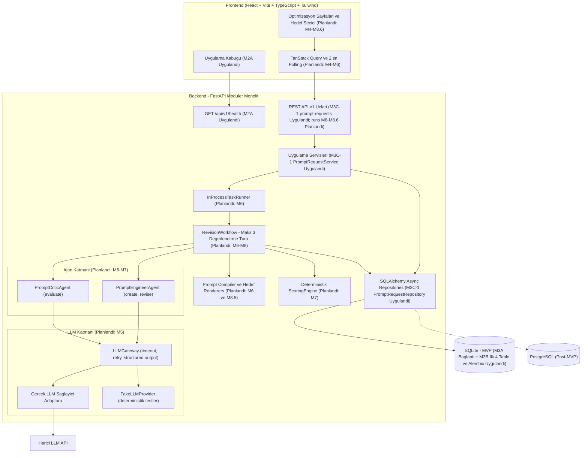
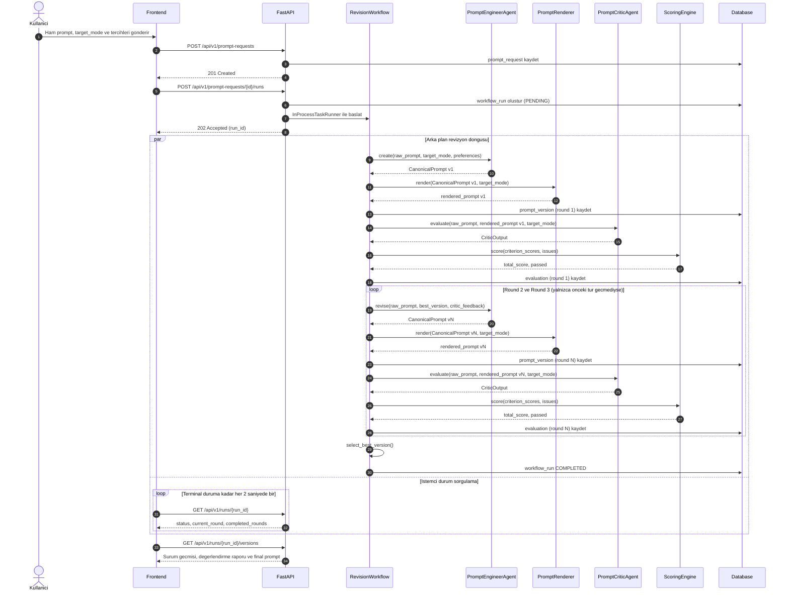
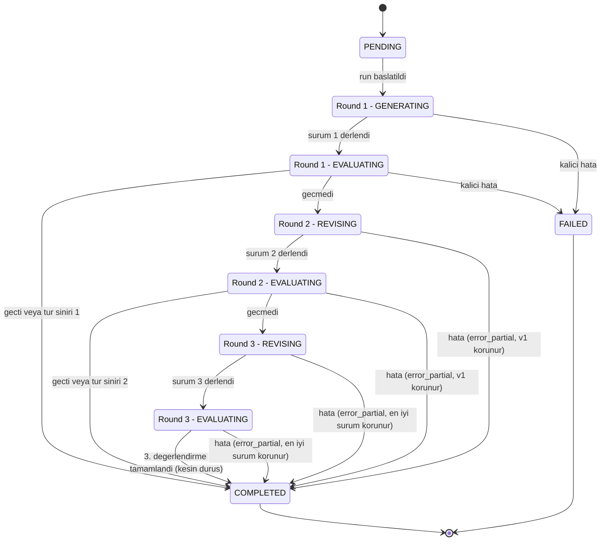
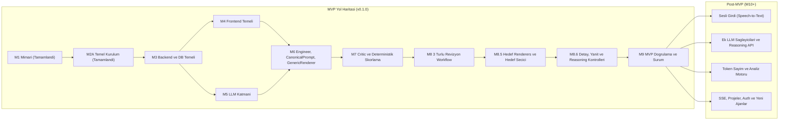

# PromptForge AI — Teknik Mimari Dokümantasyonu (v1.2)

> **Uygulama Durumu Bildirimi (Milestone 3C-1):** Bu doküman, PromptForge AI platformunun onaylanmış hedef mimarisini ve aşamalı yol haritasını tanımlar. Şu anki depoda **Milestone 2A temel altyapısı**, **Milestone 3A asenkron veritabanı bağlantı temeli**, **Milestone 3B ilk dört ORM modeli ile Alembic göç sistemi** (`0001_initial_schema`) ve **Milestone 3C-1 Prompt Yönetimi REST API, Pydantic v2 şemaları, `PromptRequestRepository` ve `PromptRequestService` katmanları** (`POST /api/v1/prompt-requests`, `GET /api/v1/prompt-requests/{id}`, `GET /api/v1/prompt-requests`) uygulanmıştır. Yapılandırılmış JSON loglama, `X-Request-ID` ve merkezi Problem Details hata yönetimi (**Milestone 3C-2**), değerlendirme tabloları (`evaluations`, `criterion_scores`, `evaluation_issues` — Milestone 7), LLM sağlayıcı entegrasyonu, AI ajanları, `CanonicalPrompt` derleyicisi, değerlendirme motoru, token analizi ve sesli girdi (Speech-to-Text) bileşenleri **henüz kodlanmamıştır**.

---

## 1. Proje Vizyonu

**PromptForge AI**, sıradan kullanıcı isteklerini yapılandırılmış, bağımsız olarak denetlenmiş ve hedef yapay zekâ modeline uygun biçimde derlenmiş yüksek kaliteli promptlara dönüştüren modüler bir çoklu ajan (multi-agent) platformudur.

Platform basit bir sohbet arayüzü değildir; temel ilkeleri şunlardır:

- **Sorumluluk ayrımı:** Üretim (`PromptEngineerAgent`) ve kalite değerlendirmesi (`PromptCriticAgent`) birbirinden bağımsız talimat ve model yapılandırmalarıyla çalışır. Hiçbir ajan kendi çıktısını bağımsız kalite onayı olarak değerlendiremez.
- **Deterministik kontrol:** Puan hesaplaması ve revizyon döngüsü kararları LLM'e bırakılmaz, uygulama kodunda deterministik kurallarla yürütülür.
- **Ara temsil ve hedef derleme (Prompt Compiler):** Prompt içeriği yapılandırılmış `CanonicalPrompt` ara temsilinde üretilir ve deterministik `PromptRenderer` modülleriyle hedef ortama (`generic`, `openai`, `anthropic`, `google`) dönüştürülür.
- **Uzun vadeli genişleme:** Mimari, ilerleyen fazlarda yazılım projelerini planlayan, geliştiren, test eden ve güvenlik açısından inceleyen 13 uzman ajana genişleyebilecek sınırlarla tasarlanmıştır.

---

## 2. Kapsam ve Uygulama Durumu

### 2.1 Mevcut Durum — Milestone 2A, 3A, 3B & 3C-1 (Uygulandı)

- `backend/` ve `frontend/` ayrımına sahip monorepo yapısı
- Python 3.12, `uv`, FastAPI uygulama fabrikası (`create_app`), `lifespan` kaynak yönetimi ve `GET /api/v1/health` uç noktası
- `pydantic-settings` ortam yapılandırması (`DATABASE_URL`, varsayılan `backend/data/promptforge.db`) ve SQLAlchemy 2.0 Async + `aiosqlite` oturum altyapısı (`DatabaseSessionManager`, `get_db_session`, yabancı anahtar kısıtları ve dosya tabanlı SQLite için WAL modu)
- SQLAlchemy 2.0 `DeclarativeBase` (`app/db/base.py`), ilk dört ORM modeli (`PromptRequest`, `WorkflowRun`, `PromptVersion`, `AgentRun`) ve CWD'den bağımsız asenkron Alembic göç sistemi (`0001_initial_schema`)
- Prompt yönetimi REST API uç noktaları (`POST /api/v1/prompt-requests`, `GET /api/v1/prompt-requests/{id}`, `GET /api/v1/prompt-requests`), Pydantic v2 doğrulama şemaları (`PromptRequestCreate`, `PromptRequestRead`, `PromptRequestListResponse`), `PromptRequestRepository` ve `PromptRequestService` (`app/modules/prompts/`)
- Otomatik OpenAPI şeması (`/docs`, `/redoc`, `/api/v1/openapi.json`)
- Ruff, `mypy --strict` ve `pytest` doğrulama altyapısı
- React 19, Vite 8, TypeScript (`strict`), Tailwind CSS v4 (`@tailwindcss/vite`), ESLint ve Vitest ile koyu temalı, duyarlı başlangıç arayüzü (sahte AI işlevi içermez)
- GitHub Actions CI iş akışı (`.github/workflows/ci.yml`)

### 2.2 Planlanan İlk MVP Kapsamı (Milestone 3 – Milestone 9)

1. Ham prompt gönderimi, bağlam bilgileri ve hedef AI modu seçimi (`generic`, `openai`, `anthropic`, `google`)
2. Temel optimizasyon kontrolleri:
   - `prompt_detail_level` (`low`, `medium`, `high`)
   - `response_detail_preference` (`minimal`, `balanced`, `comprehensive`)
   - `reasoning_preference` (`auto`, `low`, `medium`, `high`) ve görev odaklı temel çıktı politikaları
3. `PromptEngineerAgent` ile niyet analizi, belirsizlik tespiti ve `CanonicalPrompt` üretimi (`create` ve `revise`)
4. Deterministik hedef derleyicileri (`GenericPromptRenderer`, `OpenAIPromptRenderer`, `AnthropicPromptRenderer`, `GeminiPromptRenderer`)
5. Bağımsız `PromptCriticAgent` ile hedef farkındalıklı kör değerlendirme
6. Kod içinde deterministik ağırlıklı puanlama (100 üzerinden) ve kalite kapıları
7. En fazla **3 değerlendirme turu** (`evaluation_round` 1..3) ile sınırlı otomatik revizyon iş akışı
8. HTTP polling (2 sn) ile çalışma durumu izleme ve süreç içi görev yürütücüsü (`InProcessTaskRunner`)
9. Sürüm geçmişi, tur bazlı değerlendirme raporu, nihai prompt gösterimi ve panoya kopyalama

### 2.3 MVP Sonrasına (Post-MVP / M10+) Ertelenen Özellikler

- Sesli girdi / Speech-to-Text (`VoiceInput` modülü)
- Kapsamlı Token Analizi motoru ve sağlayıcıya özgü token sayım API entegrasyonları
- Sağlayıcı API'lerinde doğrudan akıl yürütme (reasoning effort) parametre kontrolü
- İkinci gerçek LLM sağlayıcısı entegrasyonu
- Server-Sent Events (SSE) canlı akışı ve çalışma iptali
- Gelişmiş onay modları, kullanıcı düzenlemesi ve satır içi diff görünümü
- Çok kullanıcılı kimlik doğrulama, proje yönetimi ve analitik gösterge paneli
- Ek uzman yazılım geliştirme ajanları (Master Prompt Architect, System Architect, Backend/Frontend Dev, QA, Security vb.)

---

## 3. Teknoloji Yığını

| Katman | Teknoloji | Durum | Seçim Gerekçesi |
|---|---|---|---|
| **Frontend** | React 19, Vite 8, TypeScript (`strict`), Tailwind CSS v4 | M2A'da kuruldu | Hızlı geliştirme döngüsü, güçlü tip güvenliği, resmi Vite eklentisiyle sade CSS yapılandırması |
| **Frontend Veri & Durum** | TanStack Query (M4), HTTP Polling | Planlandı (M4+) | Sunucu durumu önbellekleme ve 2 sn aralıklı polling için ek altyapı gerektirmez |
| **Backend** | Python 3.12, FastAPI, Pydantic v2, `uv` | M2A'da kuruldu | Async I/O uyumu, katı veri şeması doğrulaması, hızlı ve kilit dosyalı (`uv.lock`) bağımlılık yönetimi |
| **Veritabanı** | SQLite (MVP) → PostgreSQL (Gelecek), SQLAlchemy 2.0 Async + Alembic | M3A bağlantı temeli ve M3B ilk 4 ORM modeli + Alembic göç sistemi kuruldu; değerlendirme tabloları M7'de eklenecek | Yerel MVP'de sıfır kurulum yükü; lehçeden bağımsız tiplerle PostgreSQL'e doğrudan taşınabilirlik |
| **LLM Katmanı** | Sağlayıcıdan bağımsız `LLMProvider` protokolü + `FakeLLMProvider` + 1 gerçek sağlayıcı | Planlandı (M5) | Ağır orkestrasyon çerçeveleri olmadan deterministik test edilebilirlik ve model esnekliği |
| **Kalite & CI** | Ruff, mypy (`strict`), pytest, ESLint, Vitest, GitHub Actions | M2A'da kuruldu | Her değişiklikte otomatik statik analiz ve birim testi güvencesi |

---

## 4. Genel Sistem Mimarisi

PromptForge AI, katman sınırları net bir **modüler monolit** olarak tasarlanmıştır (`ADR-001`).

### 4.1 Mimari Diyagram

### 4.2 Katman Kuralları

- **Arabulucu (Mediator) ilkesi:** Ajanlar veritabanını, HTTP katmanını veya birbirlerini doğrudan çağıramaz; tüm koordinasyon `RevisionWorkflow` üzerinden yürütülür.
- **Sağlayıcı yalıtımı:** Harici SDK tipleri `llm/providers/` dışına sızmaz; ajanlar yalnızca `LLMGateway` ile konuşur.
- **Geliştirme ortamı ayrımı:** Geliştirme sırasında kullanılan IDE veya yardımcı yapay zekâ araçları, çalışma zamanındaki `LLMProvider` katmanından tamamen bağımsızdır.

### 4.3 Prompt Yönetimi API, Şema, Depo ve Servis Mimarisi (Milestone 3C-1 — Uygulandı)

- **Uç noktalar (`app/api/v1/routes/prompt_requests.py`):**
  - `POST /api/v1/prompt-requests` (`201 Created`, `Location: /api/v1/prompt-requests/{id}` başlığı ile)
  - `GET /api/v1/prompt-requests/{id}` (`200 OK`, kayıt yoksa iç veritabanı detayı sızdırmadan `404 Not Found`, geçersiz UUID için `422`)
  - `GET /api/v1/prompt-requests` (`200 OK`, `page >= 1`, `1 <= page_size <= 100`, varsayılan `page=1`, `page_size=20`)
- **Pydantic v2 şemaları ve doğrulama kuralları (`app/modules/prompts/schemas.py`):**
  - `PromptRequestCreate` (`extra="forbid"`): Bilinmeyen alanları reddeder; `raw_prompt` için boş/yalnızca-boşluk olmama ve `1..20.000` karakter sınırını zorunlu tutar; `user_context` (`<= 20.000`), `output_language` (`<= 32`) ve `task_profile` (`<= 64`) alanlarını doğrular; `app/models/enums.py` üzerindeki enum ve ORM varsayılanlarını (`generic`, `medium`, `balanced`, `auto`) tek doğruluk kaynağı olarak kullanır.
  - `PromptRequestRead` (`from_attributes=True`) ve `PromptRequestListResponse` (`items`, `total`, `page`, `page_size`) çıktı şemalarını tanımlar.
- **Depo ve servis ayrımı:**
  - `PromptRequestRepository` (`app/modules/prompts/repository.py`): FastAPI'den bağımsız olarak `AsyncSession` üzerinde parametreli SQLAlchemy 2.0 sorguları çalıştırır; sayfalama sorgularında tüm tabloyu belleğe almadan `OFFSET`/`LIMIT` ve deterministik `ORDER BY created_at DESC, id DESC` sıralaması uygular.
  - `PromptRequestService` (`app/modules/prompts/service.py`): İşlem (`commit` / hata anında açık `rollback`) sınırlarını yönetir ve bulunamayan kayıtlar için `PromptRequestNotFoundError` üretir.
- **Veritabanı ön koşulu:** FastAPI açılışında otomatik göç çalıştırılmaz; yerel veritabanı ilk kullanımdan önce açıkça `uv run alembic upgrade head` komutuyla hazırlanır.

---

## 5. CanonicalPrompt ve Hedefe Özgü Prompt Derleyicisi (Prompt Compiler)

### 5.1 Desteklenen Hedef Modlar (`ADR-011`)

Kullanıcı prompt üretimi öncesinde dört hedef moddan birini seçebilir:

| Teknik Değer (`target_mode`) | UI Gösterimi | Planlanan Renderer Modülü | Milestone |
|---|---|---|---|
| `generic` | **Universal** | `GenericPromptRenderer` | M6 |
| `openai` | **ChatGPT / GPT** | `OpenAIPromptRenderer` | M8.5 |
| `anthropic` | **Claude** | `AnthropicPromptRenderer` | M8.5 |
| `google` | **Gemini** | `GeminiPromptRenderer` | M8.5 |

### 5.2 `CanonicalPrompt` Ara Temsili

`PromptEngineerAgent`, serbest metin yerine yapılandırılmış `CanonicalPrompt` şemasını üretir:

- `role`: Uzman rol ve sorumluluk tanımı
- `context`: Arka plan ve çalışma ortamı bağlamı
- `input_data`: Modele verilecek veri veya girdi açıklamaları
- `task`: Birincil görev tanımı
- `requirements`: Karşılanması zorunlu açık gereksinimler
- `constraints`: Biçim, kapsam ve kalite kısıtları
- `prohibitions`: Yapılmaması gereken davranışlar (negatif kurallar)
- `output_format`: Beklenen çıktı yapısı
- `examples`: Doğrulanmış girdi/çıktı örnekleri (varsa yalnızca `PromptEngineerAgent` tarafından üretilir)
- `variables`: Şablon değişkenleri listesi
- `assumptions`: Belirsizlikler için açıkça beyan edilen varsayımlar

### 5.3 Renderer Kuralları ve Değerlendirme Bütünlüğü

1. **İçerik uydurmama kuralı:** Renderer modülleri saf (pure), deterministik ve sürümlü (`renderer_version`) fonksiyonlardır. Yeni gereksinim uyduramaz, önemli bilgileri silemez ve doğrulanmamış few-shot örnekleri üretemez.
2. **Hedefe özgü içerik sorumluluğu:** Seçilen hedefe uygun içerik kararları (ör. örnek üretimi veya ek negatif kısıtlar) `PromptEngineerAgent` tarafından üretilir ve `PromptCriticAgent` tarafından denetlenir.
3. **Kanıta dayalı yaklaşım:** XML etiketlerinin, Markdown başlıklarının veya few-shot örneklerinin her senaryoda otomatik üstünlük sağladığı varsayılmaz; sağlayıcı rehberlerindeki öneriler sürümlü kurallar olarak uygulanır ve değerlendirme testleriyle doğrulanır.
4. **Hedef farkındalıklı değerlendirme:** Teslim edilen nihai derlenmiş metin, bizzat `PromptCriticAgent` tarafından değerlendirilmiş sürümdür. Her değerlendirme kaydı `target_mode` ve `renderer_version` bilgisini saklar.
5. **Değerlendirme sonrası hedef değişimi:** Kullanıcı üretim tamamlandıktan sonra yeni bir değerlendirme çalıştırmadan farklı bir hedef sekmeye geçerse, arayüz bu varyantı **"bağımsız olarak değerlendirilmedi (yalnızca biçimsel yeniden derleme)"** uyarısıyla işaretler. Genel (`generic`) değerlendirme sonucunun tüm hedef modellerde aynı kaliteyi kanıtladığı iddia edilmez.

---

## 6. Optimizasyon Kontrolleri ve Bağlam Duyarlı Politikalar (`ADR-012`)

### 6.1 Üç Yapılandırma Boyutu (Milestone 8.6)

| Boyut | Değerler | İşlevi ve Sınırları |
|---|---|---|
| **A. Prompt Detail Level** (`prompt_detail_level`) | `low`, `medium`, `high` | Üretilen promptun ayrıntı düzeyini belirler. `low` seçilse dahi kullanıcının açık gereksinimleri ve temel doğruluk kısıtları **asla çıkarılmaz**. |
| **B. Response Detail Preference** (`response_detail_preference`) | `minimal`, `balanced`, `comprehensive` | Hedef modelden beklenen yanıtın kapsam ve uzunluk tercihini prompt içinde açıkça tanımlar. |
| **C. Reasoning Preference** (`reasoning_preference`) | `auto`, `low`, `medium`, `high` | İstenen akıl yürütme derinliğini temsil eder. |

> **Kritik Ayrım (Prompt İçi Yönerge vs. API Parametresi):** Kullanıcının kopyalayıp harici bir yapay zekâ arayüzüne yapıştırdığı promptta yer alan akıl yürütme tercihi yalnızca **metinsel bir yönlendirmedir**; karşı uygulamanın gerçek API `reasoning_effort` / thinking bütçesi ayarını değiştireceği garanti edilemez. Gerçek sağlayıcı API akıl yürütme kontrolü yalnızca PromptForge AI'ın uyumlu bir sağlayıcı API'sini doğrudan çağırdığı senaryolarda (Post-MVP) uygulanabilir. Sabit oranlı token tasarrufu veya garanti performans artışı vaat edilmez.

### 6.2 Bağlam Duyarlı Çıktı Politikaları

Yazılım geliştirme görev türlerine göre yapılandırılabilir varsayılan politikalar tanımlanır (kullanıcı her zaman geçersiz kılabilir):

- **Mimari tasarım (`architecture_design`):** Bütünlük, güvenlik ve ödünleşim (trade-off) analizini önceliklendirir.
- **Yeni proje geliştirme (`new_project`):** Gerekli dosya yapısını ve uygulama ayrıntılarını tam ister.
- **Hata ayıklama (`debugging`):** Hedefli yama (patch), kök neden ve ilgili testlere odaklanır.
- **Küçük değişiklikler (`minor_modification`):** İlgisiz dosyaların baştan yazılmasını engeller.
- **Yeniden düzenleme (`refactoring`):** Davranış korunumunu ve gerekli değişiklik kapsamını vurgular.
- **Güvenlik incelemesi (`security_review`):** Token azaltmak amacıyla hiçbir önemli güvenlik bulgusunun atlanmamasını şart koşar.

---

## 7. Ajan Sorumlulukları, Değerlendirme ve Revizyon İş Akışı

### 7.1 Ajan Sorumlulukları

- **`PromptEngineerAgent`:** Ham isteği, bağlamı, hedef modu ve optimizasyon tercihlerini analiz eder; belirsizlikleri ve varsayımları çıkarır; `create` modunda ilk `CanonicalPrompt`'u, `revise` modunda ise Critic bulgularına yanıt veren iyileştirilmiş sürümü üretir.
- **`PromptCriticAgent`:** Orijinal kullanıcı isteği ile derlenmiş aday promptu sabit değerlendirme ölçeğine (rubric v1) göre **kör** olarak (Engineer'ın iç gerekçelerini ve önceki toplam puanları görmeden) değerlendirir; kriter puanlarını, kanıtlı sorunları (`critical`, `major`, `minor`) ve yapılandırılmış revizyon önerilerini üretir.

### 7.2 Değerlendirme Kuralları (Rubric v1)

Toplam puan LLM tarafından değil, `ScoringEngine` tarafından deterministik olarak hesaplanır:

$$
\text{total\_score} = \sum_{i=1}^{9} \frac{s_i}{10} \times w_i \qquad (s_i \in [0, 10],\ \sum w_i = 100)
$$

- **Kriter ağırlıkları:** `intent_fidelity` (20), `clarity` (15), `completeness` (15), `structure` (10), `context_and_role` (10), `constraints_and_scope` (10), `output_format` (10), `specificity` (5), `consistency` (5).
- **Kalite kapıları (`passed = true` koşulları):** `total_score >= 85`, `critical` sorun sayısı `0` ve `intent_fidelity >= 7`.

### 7.3 Kesin Değerlendirme Turu Tanımı (`evaluation_round` 1..3)

Her optimizasyon çalıştırması (`workflow_run`) en fazla **3 değerlendirme turu** içerir (`ADR-003`):

- **Değerlendirme 1 (`evaluation_round = 1`):** İlk prompt üretimi (`create`), hedef derlemesi ve 1. Critic değerlendirmesi.
- **Değerlendirme 2 (`evaluation_round = 2`):** Kalite kapıları geçilmediyse 1. revizyon (`revise`), derleme ve 2. Critic değerlendirmesi.
- **Değerlendirme 3 (`evaluation_round = 3`):** Kalite kapıları hâlâ geçilmediyse 2. revizyon (`revise`), derleme ve 3. (son) Critic değerlendirmesi. **Sistem 3. değerlendirmeden sonra koşulsuz durur.**

Geçici ağ hataları için yapılan yeniden denemeler (`attempt`) ve şema onarım adımları tur sayısını artırmaz. Revizyon adımı her zaman o ana kadarki **en yüksek nitelikli değerlendirilmiş sürümü** temel alır (`ADR-007`).

### 7.4 Ajan Etkileşim Sıra Diyagramı

### 7.5 Durum Makinesi Diyagramı

---

## 8. Veritabanı Şeması ve Göç Mimarisi (Milestone 3B – 8.6)

Asenkron bağlantı ve oturum altyapısı (`app/db/session.py`) M3A'da, `DeclarativeBase` (`app/db/base.py`), Alembic göç sistemi (`alembic.ini`, `migrations/`, revizyon `0001_initial_schema`) ve ilk dört temel tablo ise **Milestone 3B'de uygulanmıştır**:

- **Uygulanan tablolar (Milestone 3B):** `prompt_requests`, `workflow_runs`, `prompt_versions`, `agent_runs`
- **Planlanan değerlendirme tabloları (Milestone 7):** `evaluations`, `criterion_scores`, `evaluation_issues` (henüz oluşturulmamıştır)

### 8.1 Göç (Migration) ve Bütünlük Kuralları (Milestone 3B — Uygulandı)

- **Alembic ve `DATABASE_URL` entegrasyonu:** `migrations/env.py`, `Settings().database_url` ve `create_db_engine()` altyapısını yeniden kullanır; `create_all()` kullanılmaz ve FastAPI başlangıcında otomatik göç çalıştırılmaz. Göçler `alembic.ini` (`%(here)s`) ve `build_alembic_config()` sayesinde çalışma dizininden (CWD) bağımsız olarak `uv run alembic upgrade head` ve `uv run alembic downgrade -1` / `base` komutlarıyla yürütülür.
- **Döngüsel yabancı anahtar çözümü (`WorkflowRun.final_version_id` ↔ `PromptVersion.id`):** `workflow_runs` ilk oluşturulduğunda `final_version_id` sütunu FK olmadan tanımlanır; `prompt_versions` tablosu oluşturulduktan sonra `op.batch_alter_table("workflow_runs")` (`use_alter=True`, `post_update=True`) ile `fk_workflow_runs_final_version_id_prompt_versions` (`ON DELETE SET NULL`) kısıtı eklenir. Geri alma (`downgrade`) sırasında `PRAGMA foreign_keys=ON` küresel olarak devre dışı bırakılmaz; önce `final_version_id` değerleri `NULL` yapılır, PostgreSQL gibi katalog tabanlı lehçelerde döngüsel FK düşürülür ve tablolar bağımlılık sırasıyla kaldırılır.
- **Tarihsel kayıtların korunması ve kısıtlar:** Üretim ve yürütme geçmişinin yanlışlıkla silinmemesi için ebeveyn-çocuk ilişkilerinde `ON DELETE RESTRICT` uygulanır (`CASCADE` kullanılmaz). Üç değerlendirme turu sınırı (`max_evaluation_rounds BETWEEN 1 AND 3`, `evaluation_round BETWEEN 1 AND 3`) ve sürüm tekilliği (`UNIQUE(prompt_request_id, version_number)`, `UNIQUE(agent_run_id)`) veritabanı düzeyinde zorunlu tutulur.

### 8.2 Hedef Varlık-İlişki Diyagramı (M3B Uygulanan + M7 Planlanan)

```mermaid
erDiagram
    PROMPT_REQUESTS ||--o{ WORKFLOW_RUNS : has
    PROMPT_REQUESTS ||--o{ PROMPT_VERSIONS : has
    WORKFLOW_RUNS |o--o{ PROMPT_VERSIONS : produces
    WORKFLOW_RUNS ||--o{ EVALUATIONS : contains
    WORKFLOW_RUNS ||--o{ AGENT_RUNS : records
    WORKFLOW_RUNS }o--o| PROMPT_VERSIONS : selects_final
    PROMPT_VERSIONS ||--o{ EVALUATIONS : evaluated_by
    PROMPT_VERSIONS |o--o{ PROMPT_VERSIONS : parent_of
    EVALUATIONS ||--|{ CRITERION_SCORES : contains
    EVALUATIONS ||--o{ EVALUATION_ISSUES : lists
    AGENT_RUNS ||--o| PROMPT_VERSIONS : creates
    AGENT_RUNS ||--o| EVALUATIONS : creates

    PROMPT_REQUESTS {
        uuid id PK
        text raw_prompt
        text user_context
        string output_language
        string target_mode "generic, openai, anthropic, google"
        string task_profile
        string prompt_detail_level "low, medium, high"
        string response_detail_preference "minimal, balanced, comprehensive"
        string reasoning_preference "auto, low, medium, high"
        datetime created_at
    }
    WORKFLOW_RUNS {
        uuid id PK
        uuid prompt_request_id FK
        string status
        int max_evaluation_rounds "CHECK 1..3"
        int current_round
        int completed_rounds
        json config_snapshot
        uuid final_version_id FK
        decimal final_score
        bool qualified
        string stop_reason
        string error_code
        text error_message
        datetime created_at
        datetime started_at
        datetime finished_at
    }
    PROMPT_VERSIONS {
        uuid id PK
        uuid prompt_request_id FK
        uuid workflow_run_id FK
        uuid parent_version_id FK
        uuid agent_run_id FK
        int version_number
        int evaluation_round "CHECK 1..3"
        string source
        string target_mode
        string renderer_name
        string renderer_version
        json canonical_prompt
        text rendered_prompt
        json analysis
        json change_summary
        datetime created_at
    }
    EVALUATIONS {
        uuid id PK
        uuid prompt_version_id FK
        uuid workflow_run_id FK
        uuid agent_run_id FK
        int evaluation_round "CHECK 1..3"
        string evaluated_target_mode
        string evaluated_renderer_version
        string rubric_version
        decimal total_score
        string grade
        bool passed
        json gate_results
        text summary
        datetime created_at
    }
    CRITERION_SCORES {
        uuid id PK
        uuid evaluation_id FK
        string criterion
        int score
        int weight
        decimal weighted_score
        text rationale
    }
    EVALUATION_ISSUES {
        uuid id PK
        uuid evaluation_id FK
        string issue_key
        string severity
        string criterion
        text description
        text evidence
        text recommendation
        int priority
    }
    AGENT_RUNS {
        uuid id PK
        uuid workflow_run_id FK
        string agent_name
        string agent_version
        string instruction_version
        string operation
        int evaluation_round
        string provider
        string model
        json parameters
        string status
        int attempt_count
        bool repair_attempted
        int input_tokens
        int output_tokens
        int latency_ms
        text error_message
        datetime started_at
        datetime finished_at
    }
```

---

## 9. Planlanan Post-MVP Mimarileri

### 9.1 Token Analizi Mimarisi (`ADR-013` — Post-MVP)

Gelecekteki `TokenAnalysis` modülü, iç yürütme maliyeti ile üretilen promptun dış kullanım tüketimini kesin biçimde ayırır:

1. **Prompt girdi tokenları (`prompt_input_tokens`):** Derlenen promptun hedef modelde kaplayacağı girdi boyutu (desteklenen sağlayıcılarda resmi token sayım API'leriyle, diğer durumlarda açıkça **"yaklaşık tahmin (approximation)"** etiketi taşıyan yerel tahminleyicilerle hesaplanır).
2. **Beklenen görünür çıktı uzunluğu (`expected_visible_output_range`):** Yanıt detay tercihine göre yaklaşık aralık; kesin tahmin olarak sunulmaz.
3. **Akıl yürütme tokenları (`reasoning_tokens`):** Yalnızca doğrudan çağrılan sağlayıcı API'si raporladığında gösterilir.
4. **Gerçek API token kullanımı (`actual_api_usage`):** Doğrudan API çağrılarından dönen kesin sayaçlar.
5. **Tahmini aşağı akış kullanımı (`estimated_downstream_usage`):** Prompt başka bir uygulamaya kopyalandığında oluşabilecek kaba aralık tahmini (kesinlik iddiası taşımaz; "%60 garanti tasarruf" gibi desteksiz ifadeler kullanılmaz).
6. **PromptForge iç ajan tüketimi (`internal_agent_execution_usage`):** Engineer ve Critic çalıştırmalarının `agent_runs` tablosunda tutulan gerçek iç tüketimi.

### 9.2 Gelecek Sesli Girdi / Speech-to-Text Mimarisi (`ADR-014` — Post-MVP)

Gelecekteki `VoiceInput` modülü aşağıdaki ilkelerle planlanmıştır:

- Tarayıcı mikrofon izin yönetimi, hata durumları ve kayıt kontrolü
- Değiştirilebilir `TranscriptionProvider` arayüzü (ilk aşamada özel bir transkripsiyon API'si ile)
- Türkçe, İngilizce ve Türkçe/İngilizce karışık yazılım terminolojisi desteği
- **Düzenlenebilir transkripsiyon ve zorunlu kullanıcı onayı:** Ses metne çevrildikten sonra doğrudan ajan döngüsüne sokulmaz; kullanıcı metni inceler, düzenler ve açıkça onayladıktan sonra optimizasyon başlar.
- **Gizlilik odaklı ses işleme:** Ham ses kayıtları varsayılan olarak kalıcı veritabanında saklanmaz, yalnızca transkripsiyon süresince bellekte/geçici akışta işlenir.

---

## 10. Geliştirme Yol Haritası

| Milestone | Kapsam Özeti | Durum |
|---|---|---|
| **M1** | Mimari tasarım ve kararların onaylanması | Tamamlandı |
| **M2A** | Monorepo iskeleti, FastAPI `/api/v1/health`, React + Tailwind başlangıç kabuğu, test/lint/CI, mimari ve ADR dokümanları | Tamamlandı |
| **M3A** | `pydantic-settings` ortam yapılandırması, SQLite (`backend/data/promptforge.db`) + SQLAlchemy 2.0 Async motoru, oturum yaşam döngüsü ve PostgreSQL uyumlu bağlantı katmanı | **Tamamlandı** |
| **M3B** | İlk dört ORM modeli (`prompt_requests`, `workflow_runs`, `prompt_versions`, `agent_runs`) ve asenkron Alembic göç altyapısı (`0001_initial_schema`) | **Tamamlandı** |
| **M3C-1** | Prompt yönetimi REST API uç noktaları (`POST/GET /api/v1/prompt-requests`), Pydantic v2 doğrulama şemaları, `PromptRequestRepository` ve `PromptRequestService` | **Tamamlandı** |
| **M3C-2** | Yapılandırılmış JSON loglama, `X-Request-ID` ara katmanı ve merkezi RFC 9457 Problem Details hata yönetimi | Planlandı |
| **M4** | Frontend yönlendirme, API istemcisi, TanStack Query ve prompt gönderim formu | Planlandı |
| **M5** | `LLMProvider` protokolü, `LLMGateway`, `FakeLLMProvider` ve ilk gerçek LLM sağlayıcı adaptörü | Planlandı |
| **M6** | `PromptEngineerAgent`, `CanonicalPrompt` ara temsili ve `GenericPromptRenderer` | Planlandı |
| **M7** | Bağımsız `PromptCriticAgent`, rubric v1 ve deterministik `ScoringEngine` | Planlandı |
| **M8** | En fazla 3 değerlendirme turlu otomatik `RevisionWorkflow` ve en iyi sürüm seçimi | Planlandı |
| **M8.5** | `OpenAIPromptRenderer`, `AnthropicPromptRenderer`, `GeminiPromptRenderer`, hedef AI seçici ve hedef farkındalıklı değerlendirme | Planlandı (MVP Zorunlu) |
| **M8.6** | `prompt_detail_level`, `response_detail_preference`, `reasoning_preference` üst verisi ve görev bazlı temel optimizasyon politikaları | Planlandı (MVP Zorunlu) |
| **M9** | Uçtan uca doğrulama, kalite değerlendirme seti ve `v0.1.0` MVP sürümü | Planlandı |
| **Post-MVP** | Speech-to-Text, ek LLM sağlayıcıları, sağlayıcıya özgü token sayımı ve analitiği, doğrudan reasoning API kontrolleri, uzman yazılım ajanları | Planlandı |

